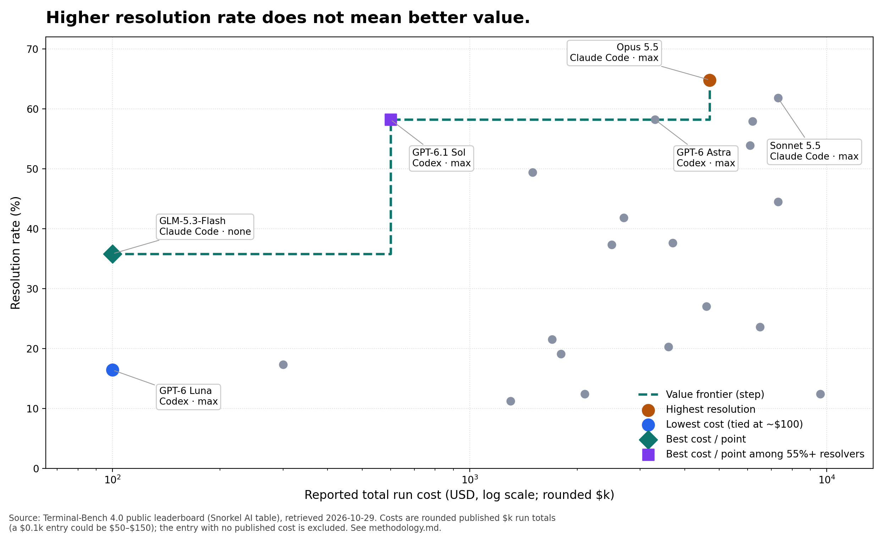
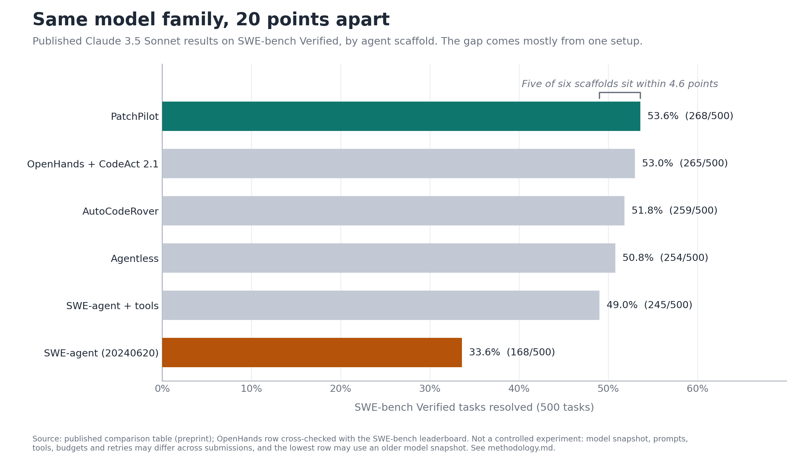
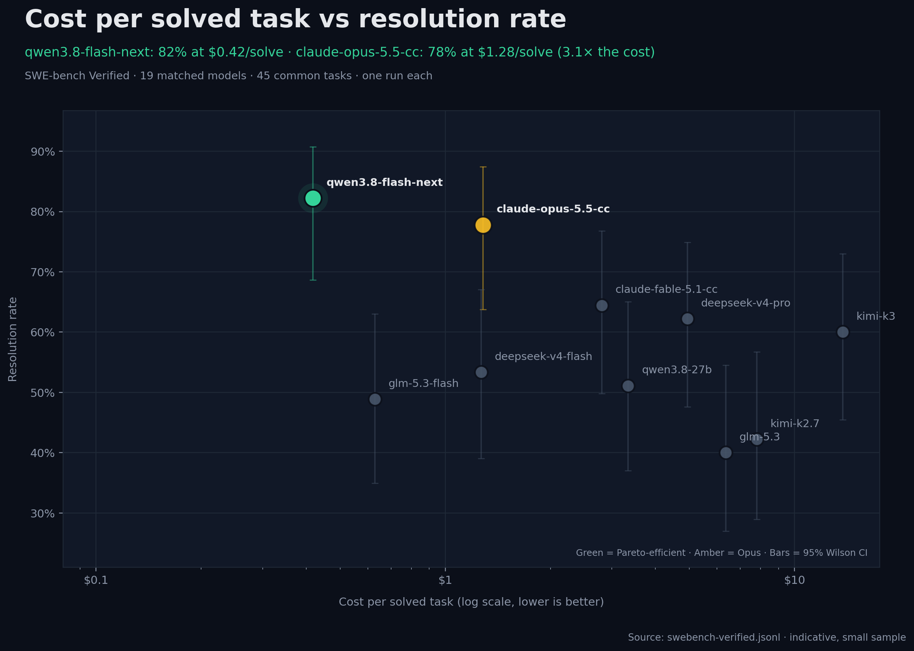

# Benchmark Analysis

**Craig ML Dsouza · Benchmark storytelling for AI products**

I turn public AI benchmark results into decision-ready stories: what improved, what
it cost, which parts of the system matter, and where the evidence stops. This
repository is a working portfolio of analyses, charts, and reproducible research
notes—not a vendor leaderboard or a claim that one benchmark settles product fit.

The work is designed for the conversation between product, engineering, and go-to-market
teams: explain the metric, make the trade-off legible, and give every conclusion
enough context to be repeated responsibly.

## Selected work

### Terminal-Bench 4.0 — capability has a price

**Story:** Compare reported resolution rate with total evaluation-run spend, while
keeping model, agent, and effort visible as parts of the tested configuration.

**Signal:** One published configuration reports 58.2% resolution at approximately
$600, compared with 64.8% at approximately $4,700 for the highest-scoring
configuration. That is a useful efficiency question—not a controlled head-to-head
or a production-cost estimate.

[Analysis and caveats](Terminal-Bench-4.0/README.md) ·
[Methodology](Terminal-Bench-4.0/methodology.md)

### SWE-bench Verified — the scaffold is part of the result

**Story:** Show how published system results can differ even when a comparison
names the same model family.

**Signal:** Six published Claude 3.5 Sonnet configurations range from 33.6% to
53.6% on SWE-bench Verified, a 20-percentage-point observed spread. The submissions
are not a matched experiment, so the gap does not isolate a causal scaffold effect.

[Analysis and caveats](SWE-bench/README.md) ·
[Methodology](SWE-bench/methodology.md)

### SWE-bench Verified — spend and failure modes

**Story:** Look beyond a headline score to matched-task outcomes, cost per solve,
and where unsuccessful runs consume budget.

**Signal:** In this separate, small 45-task run sample, 19 configurations cover
the same tasks. The analysis reports both resolution and logged spend; it is not
the official leaderboard and should not be read as a general model ranking.

[Analysis and reproduction guide](SWE-Bench-Verified/README.md)

### Coval voice benchmarks — uncertainty changes the story

**Story:** Re-analyze published TTS/STT aggregates to test ranking stability,
frontier uncertainty, and sensitivity to the latency metric.

**Signal:** Published latency rankings and word-error-rate comparisons have
different uncertainty profiles. The analysis uses reconstructed distributions
from published quantiles; it does not inspect individual transcripts or re-run
providers.

[Analysis and reproduction guide](Coval/README.md)

### Search APIs — an exploratory cost model

An exploratory chart compares answer accuracy with an estimated all-in cost that
adds snippet-token cost to listed endpoint pricing. It is explicitly provisional:
the source data is embedded in the script, endpoint measurements are not
contemporaneous, and the token price is an assumption.

[Chart and assumptions](openbenchmarks/README.md)

## How to use this repository

Each project is self-contained. Start with its README for scope and reproduction
steps, then read the linked methodology before reusing a result.

| Project | Main artifact | Rebuild |
| --- | --- | --- |
| [Terminal-Bench 4.0](Terminal-Bench-4.0/README.md) | [Chart](Terminal-Bench-4.0/chart.png) | `python chart.py` from that folder |
| [SWE-bench scaffold comparison](SWE-bench/README.md) | [Chart](SWE-bench/chart.png) | `python chart.py` from that folder |
| [SWE-bench matched-run analysis](SWE-Bench-Verified/README.md) | [Cost chart](SWE-Bench-Verified/cost_vs_resolution.png) | `python main.py`, then `python chart.py` from that folder |
| [Coval TTS/STT analysis](Coval/README.md) | [PDF report](Coval/output/Dsouza_Coval_Voice_Benchmarks_Scoped_Analysis.pdf) | Install `Coval/requirements.txt`, then run the pipeline described there |
| [Search API cost exploration](openbenchmarks/README.md) | [Chart](openbenchmarks/benchmark_teardown_6_chart.png) | `python chart.py` from that folder |

Most projects use Python 3 and local data; the Coval pipeline additionally needs
the packages in its `requirements.txt`. Refer to each project guide for exact
dependencies and inputs. No project requires API credentials to reproduce its
checked-in analysis.

## Editorial and analytical standards

- **Name the unit of comparison.** A benchmark result belongs to a tested
  configuration—model, agent/scaffold, settings, and evaluation—not a model name
  in isolation.
- **Keep denominators and cost definitions visible.** A run-total benchmark cost
  is not the same as cost per query, solved task, or production workload.
- **Separate observation from explanation.** Association, ranking, and
  descriptive ratios are not presented as causal effects.
- **Show uncertainty and snapshot dates where available.** Dynamic leaderboards
  and sampled evaluations can change the conclusion.
- **Preserve limitations beside the story.** Each project links its sources,
  inclusion rules, assumptions, and known caveats.

Third-party benchmark data and marks remain with their respective publishers.
Check the source project's license and methodology before redistributing data or
artifacts. This repository does not run model evaluations unless a project
explicitly says otherwise.

## Contact

For benchmark analysis, evaluation narratives, or technical GTM storytelling,
connect with **Craig ML Dsouza** on [GitHub](https://github.com/CraigMLdsouza).
