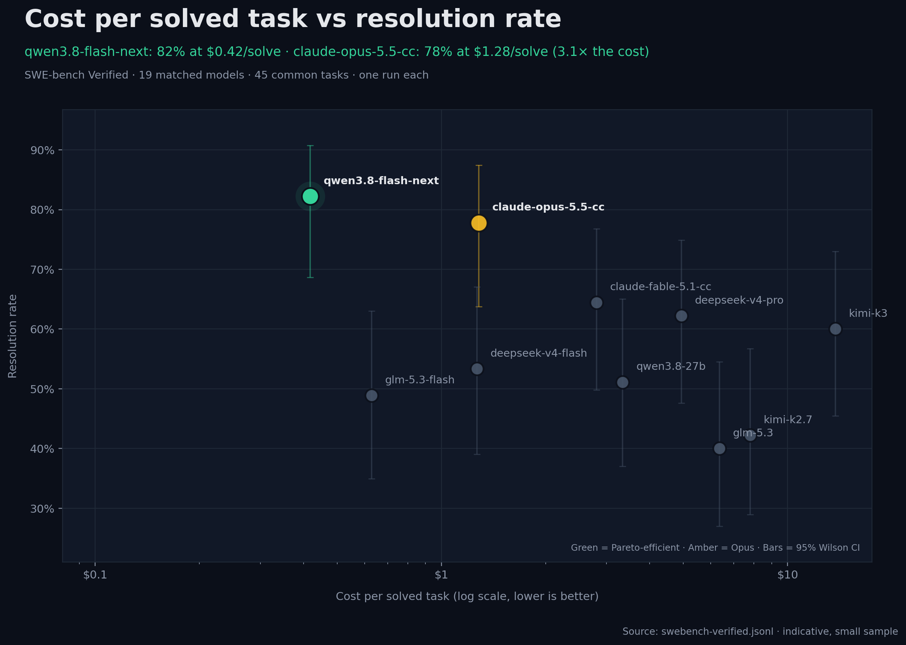

# SWE-bench Verified: cost, outcomes, and failure modes

This project analyzes a local JSONL snapshot of run-level results and compares
configurations on a common task set. Its purpose is to make the operational
trade-offs behind a score visible: resolution rate, logged spend, cost per solve,
and unsuccessful run outcomes.

## Scope

The checked-in dataset contains 45 common tasks across 19 configurations (855
runs; one recorded run per configuration and task). This is a small,
matched-task sample, **not the official SWE-bench Verified leaderboard** and not
a controlled product evaluation. Results may reflect the particular harness,
model snapshot, execution settings, and dataset snapshot.

The cost analysis includes spend on failed runs when calculating cost per solve.
Confidence intervals on resolution are descriptive for these 45 tasks; they do
not capture run-to-run variability. Do not generalize the point estimates to
other tasks or production workloads.

## Artifacts

- `cost_vs_resolution.png` — cost per solved task versus resolution rate
- `cost_per_solve.png` — ranked cost-per-solve view
- `failure_anatomy.png` — run outcomes by model and spend share
- `results_summary.txt`, `failure_summary.txt` — text summaries
- CSV files — matched-task analysis tables and outcome breakdowns



## Reproduce

Requirements: Python 3, pandas, numpy, and matplotlib. From this directory:

```bash
python -m pip install pandas numpy matplotlib
python main.py
python chart.py
python chart-2.py
```

`main.py` reads `swebench-verified.jsonl` by default, creates the matched-task
tables and summary, then `chart.py` builds the cost charts. `chart-2.py` creates
the failure breakdown and its associated tables. To analyze a different JSONL
file, pass its path to `main.py` or `chart-2.py`; the scripts write their outputs
to the current directory.

## Interpretation and provenance

The input JSONL is a snapshot, not an official leaderboard export. The scripts
match configurations on tasks, calculate Wilson intervals for observed
resolution rates, and use a paired task bootstrap for the selected head-to-head
comparison. No models are run during reproduction.

Before sharing results externally, identify the snapshot and evaluation setup,
and validate data provenance and redistribution terms. Treat comparisons as
descriptive evidence, not a model procurement recommendation.
