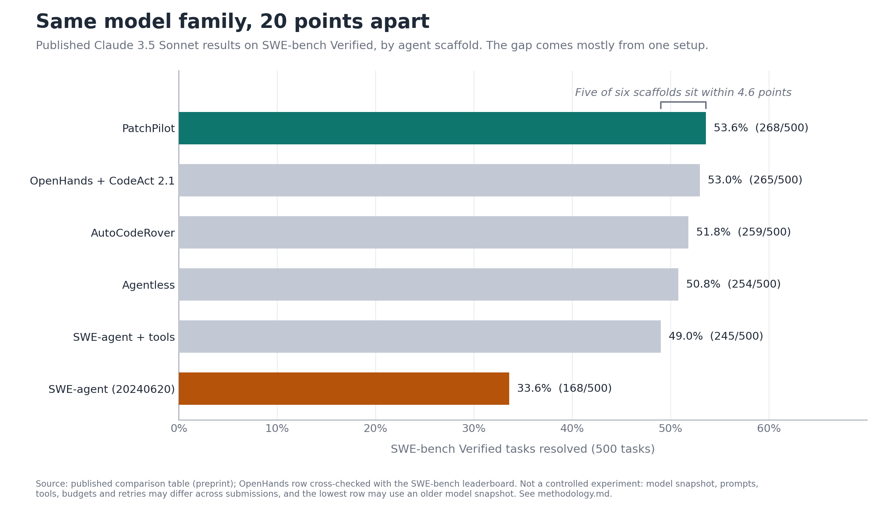

# SWE-bench Verified: scaffold comparison

This project visualizes six published SWE-bench Verified results that name the
Claude 3.5 Sonnet model family. The story is the observed spread across complete
agent configurations—not a claim that the scaffold alone caused the difference.



## Finding

The reported range is 33.6% to 53.6%, a 20-percentage-point difference (100
additional resolved tasks out of 500 between the endpoints). The source does not
establish that every submission used the same model snapshot, prompts, tools,
budgets, or retry policy. Treat this as configuration sensitivity, not a causal
scaffold effect or a current leaderboard ranking.

## Reproduce

Requirements: Python 3, pandas, and matplotlib. From this directory:

```bash
python -m pip install pandas matplotlib
python chart.py
```

The chart is regenerated from the checked-in `scaffold_comparison.csv`.
`swebench_verified_data.csv` retains the transcribed rows and source URL;
`scaffold_gap_summary.csv` contains the summary calculation.

## Sources and methodology

The comparison table is the primary source for the transcribed rows; the
OpenHands result is cross-checked against the official SWE-bench leaderboard.
See [methodology.md](methodology.md) for source links, inclusion criteria,
calculations, and publication-safe wording. Do not mix these Verified results
with SWE-bench Lite or Full.
