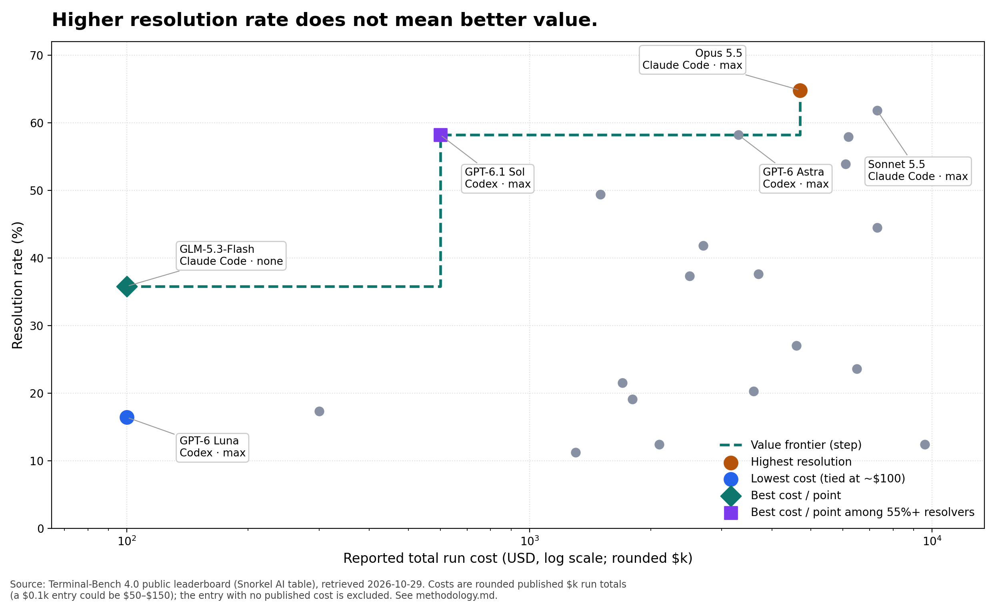

# Terminal-Bench 4.0: cost and resolution

This analysis turns a published leaderboard snapshot into a view of the
capability/spend trade-off. The unit is the **model + agent + effort configuration**,
not the model alone.

## Read the result carefully

The chart plots reported resolution rate against approximate total evaluation-run
cost. In the snapshot, GPT-6.1 Sol reports 58.2% at about $600, while Opus 5.5
reports 64.8% at about $4,700. This can prompt a value discussion; it is not a
controlled model comparison, a per-task cost estimate, or a production forecast.



## Reproduce the chart

Requirements: Python 3, pandas, and matplotlib. From this directory:

```bash
python -m pip install pandas matplotlib
python chart.py
```

`chart.py` reads the checked-in `analysis.csv` and writes `chart.png`. The
underlying transcribed leaderboard rows are not included as a separate raw-data
file, so the chart is reproducible from the analysis table, but the transcription
is not independently regenerated by this repository.

## Sources and methodology

The rows were transcribed from the Snorkel AI Terminal-Bench 4.0 leaderboard,
retrieved 2026-10-29, and interpreted alongside the official benchmark release.
The chart excludes the entry without a displayed cost. Costs are rounded
published run totals, converted from `$k` to approximate USD; points and rankings
are therefore approximate.

See [methodology.md](methodology.md) for inclusion rules, cost calculations,
source links, and limitations. The benchmark has documented scoring concerns;
the results should be treated as indicative, not definitive.
