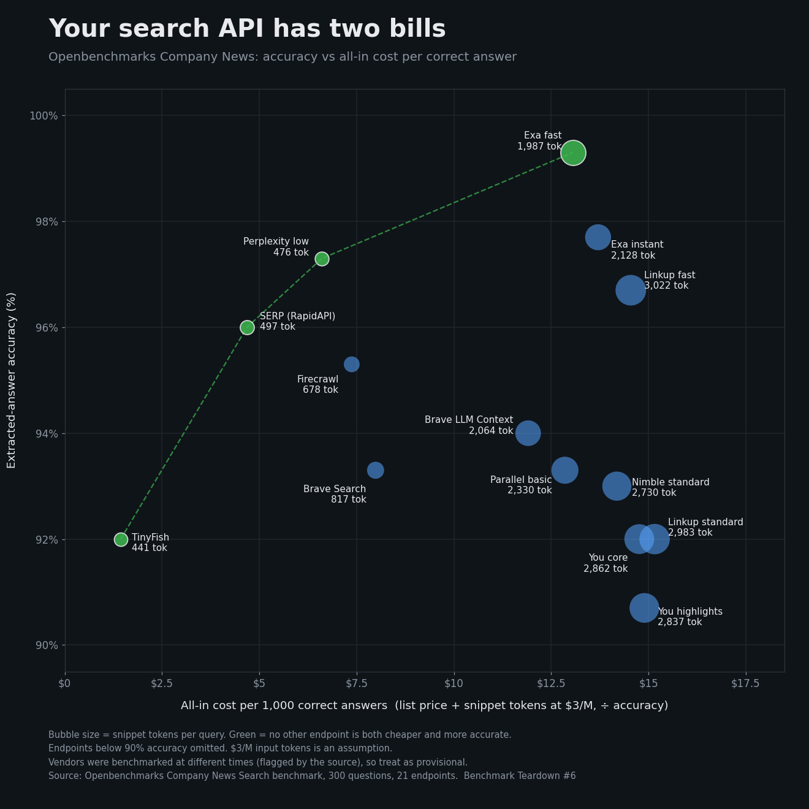

# Search API benchmark: exploratory cost model

This chart explores the relationship between extracted-answer accuracy and
estimated all-in cost for search endpoints. It adds an assumed snippet-token
processing cost to the source's listed price and divides by accuracy to estimate
cost per 1,000 correct answers.



## Important caveats

- The observations are embedded in `chart.py`; no source data table or raw
  question-level results are included, so the visualization is not a complete
  independent reproduction of the benchmark.
- The `$3 per million input tokens` rate is an editable modeling assumption, not
  an observed universal cost.
- Endpoint tests were run at different times according to the source. The chart
  is exploratory and should not be presented as a current, controlled vendor
  ranking.
- The chart omits endpoints below 90% accuracy. See the script for the embedded
  rows and calculation details.

## Reproduce

Requirements: Python 3 and matplotlib. From this directory:

```bash
python -m pip install matplotlib
python chart.py
```

This regenerates `benchmark_teardown_6_chart.png` from the values and assumptions
in the script. Consult the cited Openbenchmarks Company News Search benchmark
source before reusing its data or claims.
